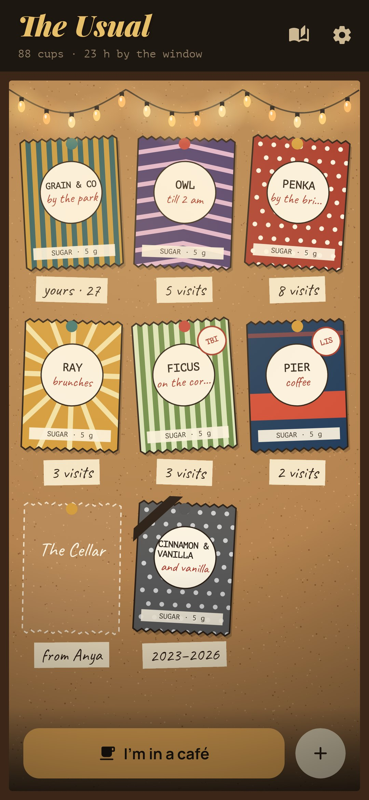
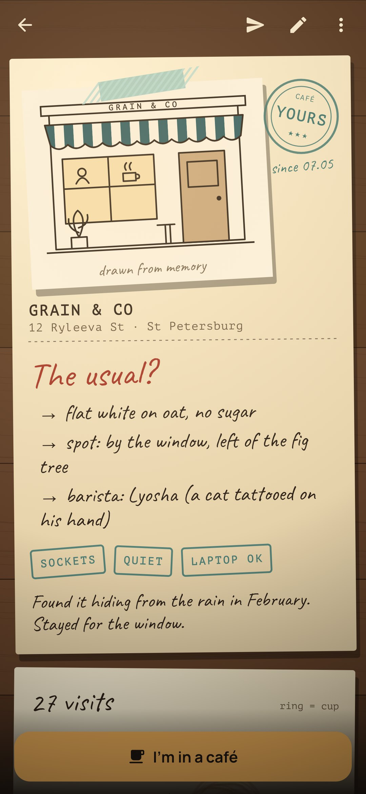
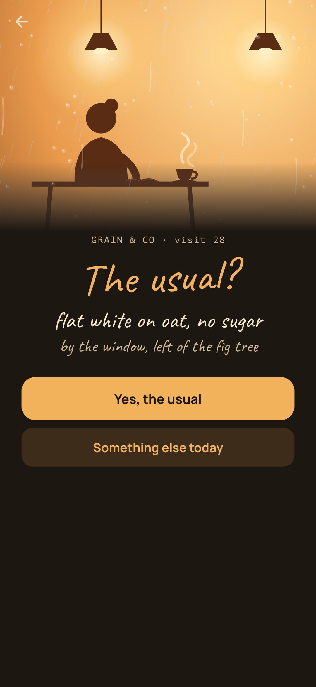
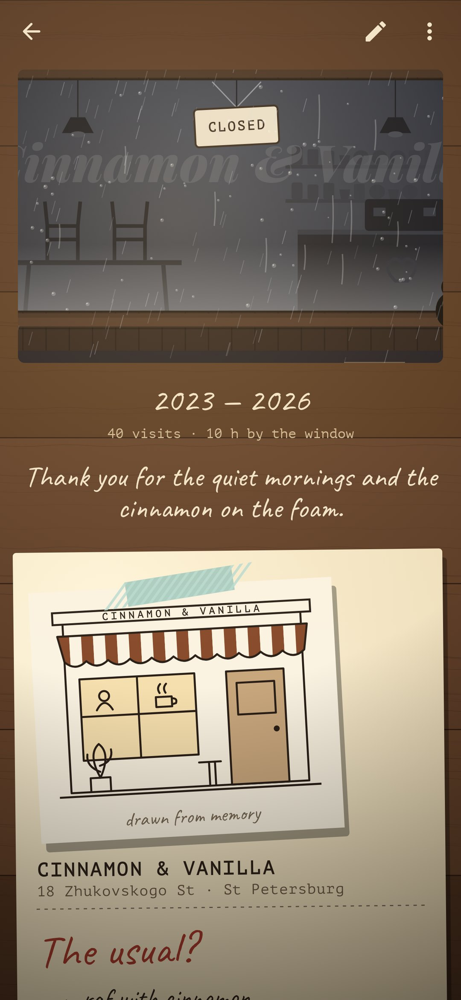

<div align="center">


# The Usual

### A diary of the cafés you keep coming back to.

*Every café gets a page in a notebook and a sugar packet on a cork board under string lights. Every cup leaves a ring on the page, and the rings pile up where your cup always lands. From the tenth visit the café is yours, and the app asks the barista's question: the usual? Send a friend a packet with what to order, keep the page of a café that closed, and sit an hour by the window with the phone face down. Free, no ads, no account, no internet.*

[](https://github.com/bigdevwhale/theusual/actions/workflows/android.yml)
[](https://github.com/bigdevwhale/theusual/releases/latest)


[](LICENSE)

**English** · [Русский](README.ru.md) · [Changelog](CHANGELOG.md)

   

</div>

---

## The idea

Map apps rate cafés by strangers' stars. But the cafés that matter are the few you return to: where the barista knows the order, where you have a spot by the window, where you once argued with a friend for three hours. The Usual is a notebook for those places, and for the small ritual of going back.

## How it works

1. **A page for every café.** Its name and address, a photo of the front redrawn on the phone as an ink sketch (or a front drawn from memory in the packet's colours), the stamps (sockets, quiet, laptop OK, open late…) and a line of its story.
2. **A sugar packet on the board.** Every café gets a packet in one of five prints and ten colourways, pinned to a cork board under string lights with a paper tag: "yours · 27", "8 visits", "from Anya", "2019–2026".
3. **A ring for every cup.** "I'm in a café" writes down a cup. Its ring goes on the right-hand page in the colour of the drink, and cups of the usual pile up where your cup always lands. A line beside a ring: who was there, what happened.
4. **The usual?** Write it down, or just order the same thing twice and it writes itself. From the tenth visit the café is stamped *yours*, and walking in, one tap answers "Yes, the usual".
5. **An hour by the window.** Put the phone face down and look out: time counts only while it lies face down, and goes onto the cup.
6. **Packets for friends.** Send a café as a sugar packet with a sticky note ("get the filter, sit on the windowsill"). It travels as plain text through any messenger; a friend with The Usual shares it back in, and it lands on their board as a dashed "want to go" packet.
7. **When a café closes.** Its page stays, with every ring, and the window on it goes dark: chairs up on the table, a sign on the door, and your last line. The packet gets a black ribbon.
8. **The year in cups.** A long till receipt: cups, cafés, the new ones, hours by the window, the most faithful place, the drink and the company of the year, the closed ones, and your own price index of the drink you order most.

## Privacy

There's no account, no ads, no analytics, and no internet permission at all. The diary stays on the phone. Photos are taken with the phone's own camera app, redrawn as sketches on the phone, and only the sketch is kept.

## Building

```bash
./gradlew testDebugUnitTest assembleDebug              # app.theusual.dev, next to a real install
./gradlew assembleDebug -Pdemo                         # app.theusual.demo with a lived-in diary
./gradlew testDebugUnitTest -Prender --tests '*RenderArtScreens*' && python tools/shots.py   # screenshots
python tools/icon.py                                   # the logo
python tools/res.py                                    # themes, the launcher icon, the camera's file paths
```

Kotlin, Jetpack Compose, Room, DataStore. Everything is drawn in code: the rainy café window, the sugar packets, the cork board and string lights, the notebook, the coffee rings, the cup from above.

## License

[MIT](LICENSE). Fonts: Playfair Display, Caveat, Manrope and PT Mono, all under the SIL Open Font License.
