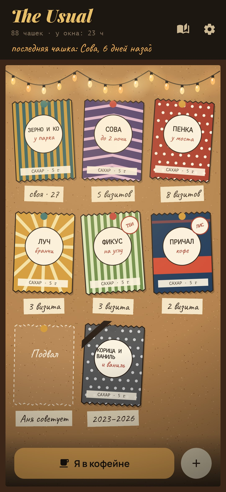
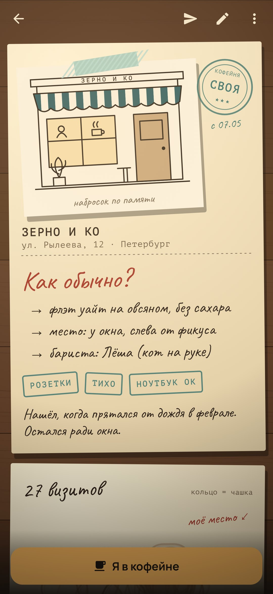
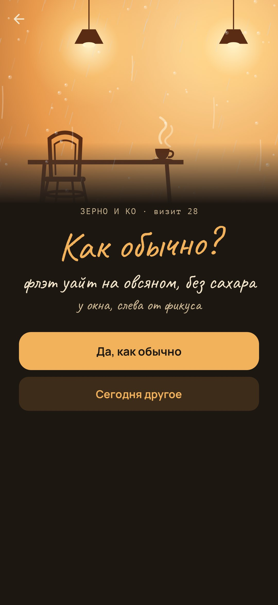
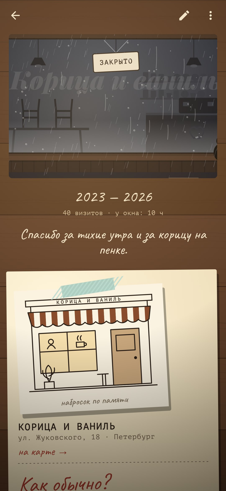

<div align="center">


# The Usual

### Дневник кофеен, куда ты возвращаешься.

*У каждой кофейни своя страница в блокноте и сахарный пакетик на пробковой доске под гирляндой. Каждая чашка оставляет на странице кольцо, и кольца ложатся друг на друга там, куда ты всегда ставишь чашку. С десятого визита кофейня становится твоей, и приложение спрашивает, как бариста: как обычно? Отправь другу пакетик с подсказкой, что заказать, сохрани страницу закрывшейся кофейни, посиди час у окна с телефоном экраном вниз. Бесплатно, без рекламы и без аккаунта.*

[](https://github.com/bigdevwhale/theusual/actions/workflows/android.yml)
[](https://github.com/bigdevwhale/theusual/releases/latest)


[English](README.md) · **Русский** · [Изменения](CHANGELOG.md)

   

</div>

---

## Идея

Карты оценивают кофейни звёздами незнакомцев. Но важны те немногие, куда ты возвращаешься: где бариста знает твой заказ, где у тебя место у окна, где вы однажды три часа спорили с другом. The Usual — блокнот для таких мест и для маленького ритуала возвращения.

## Как это устроено

1. **Страница для каждой кофейни.** Название и адрес, фото фасада, которое телефон перерисовывает в набросок тушью (или фасад «по памяти» в цветах пакетика), штампы (розетки, тихо, ноутбук ок, допоздна…) и пара строк истории.
2. **Сахарный пакетик на доске.** У каждой кофейни пакетик: пять принтов, десять расцветок. Он приколот к пробковой доске под гирляндой, с бумажной биркой: «своя · 27», «8 визитов», «Аня советует», «2019–2026».
3. **Кольцо за каждую чашку.** «Я в кофейне» записывает чашку. Её кольцо ложится на правую страницу цветом напитка, а чашки «как обычно» собираются там, куда ты всегда ставишь чашку. Рядом с кольцом — строчка: с кем был, что случилось.
4. **Как обычно?** Запиши сам или просто закажи одно и то же дважды — запишется само. С десятого визита на странице штамп «своя», и одно касание отвечает: «Да, как обычно».
5. **Час у окна.** Положи телефон экраном вниз и посмотри в окно: время идёт, только пока он так лежит, и записывается к чашке.
6. **Пакетики друзьям.** Отправь кофейню пакетиком со стикером («возьми фильтр, садись на подоконник»). Он уходит обычным текстом через любой мессенджер; друг с The Usual делится им обратно, и пакетик ложится к нему на доску пунктиром — «хочу зайти».
7. **Когда кофейня закрывается.** Страница остаётся со всеми кольцами, а окно на ней гаснет: стулья на столах, табличка на двери и твоя последняя строчка. На пакетике — траурная лента.
8. **Карта.** Твои кофейни маленькими пакетиками на плане OpenStreetMap в сепии, по городам. Поставить кофейню на карту можно кнопкой «Я здесь» или подвинув карту под булавку; пакетик, отправленный другу, несёт и место.
9. **Год в чашках.** Длинный чек: чашки, кофейни, новые открытия, часы у окна, самая верная, напиток и компания года, закрывшиеся и твой личный индекс цены любимого напитка.

## Приватность

Ни аккаунта, ни рекламы, ни аналитики. Дневник остаётся в телефоне. В интернет приложение ходит только за фрагментами карты OpenStreetMap, а геолокацию читает, только когда ты нажимаешь «Я здесь», чтобы поставить кофейню на карту. Фото снимает обычная камера телефона, набросок рисуется прямо на телефоне, хранится только он.

## Сборка

```bash
./gradlew testDebugUnitTest assembleDebug              # app.theusual.dev рядом с обычной установкой
./gradlew assembleDebug -Pdemo                         # app.theusual.demo с обжитым дневником
./gradlew testDebugUnitTest -Prender --tests '*RenderArtScreens*' && python tools/shots.py   # скриншоты
```

Kotlin, Jetpack Compose, Room, DataStore. Всё нарисовано кодом: дождливая витрина, пакетики, доска и гирлянда, блокнот, кольца от чашек, чашка сверху.

## Лицензия

[MIT](LICENSE). Шрифты: Playfair Display, Caveat, Manrope и PT Mono — SIL Open Font License.
